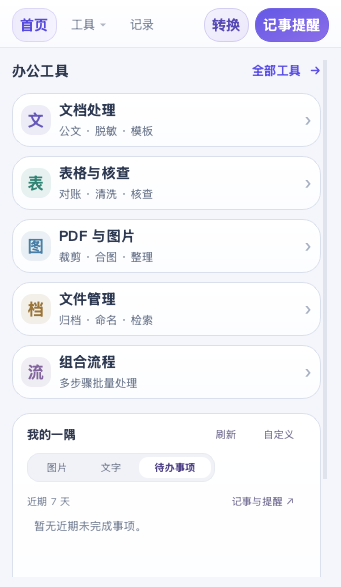
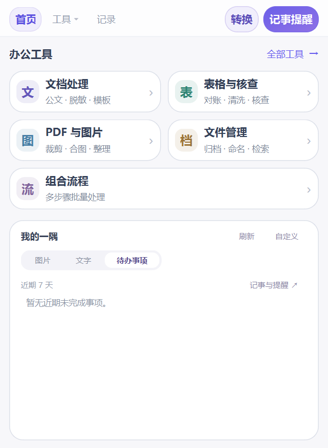

# 青简工具箱

面向日常职场办公的本地工具合集，使用 Python + Qt，提供独立中文界面。重点是公文批量处理、材料核查与拖拽转换。

<!-- MACOS_DOWNLOADS -->
## macOS 试用版 v0.12.0

[打开 Mac 下载页](https://github.com/gintoki2024/qingjian-toolbox/releases/tag/v0.12.0-macOS)。适用 macOS 14.4 及以上；首次运行完整包无需安装 Python 或转换组件。

| Mac 下载包 | 适用电脑 |
| --- | --- |
| [轻量源码包](https://github.com/gintoki2024/qingjian-toolbox/releases/download/v0.12.0-macOS/QingjianToolbox-v0.12.0-macOS-Source.zip) | 苹果芯片 / Intel 通用；首次补齐组件需要联网，可复用已有兼容 Python 或选择部署位置 |
| [苹果芯片完整包](https://github.com/gintoki2024/qingjian-toolbox/releases/download/v0.12.0-macOS/QingjianToolbox-v0.12.0-macOS-arm64-Full.zip) | M 系列 Mac，arm64 |
| [Intel 完整包](https://github.com/gintoki2024/qingjian-toolbox/releases/download/v0.12.0-macOS/QingjianToolbox-v0.12.0-macOS-x86_64-Full.zip) | Intel Mac，x86_64 |

完整解压后双击 `启动青简工具箱.command`。根目录仅有启动器、使用说明、程序文件三项；源码升级保留包外共享环境。两种架构均完成真实 Mac 启动、27 页界面、57 项业务、9 项原生转换及 187 项针对性回归，附 SHA256 和来源记录。

本版未提供 Apple Developer ID 签名或公证，首次打开按随包说明通过系统“隐私与安全性”的正常入口处理。Finder 拖住文件时的滚轮翻页、通知/休眠唤醒及多屏吸附仍需实际桌面操作确认；Mac 字体差异可能影响公文分页。



## Windows 当前正式版

<!-- DOWNLOAD_LINK -->
[下载 v0.11.2](https://github.com/gintoki2024/qingjian-toolbox/releases/tag/v0.11.2) · [全部版本](https://github.com/gintoki2024/qingjian-toolbox/releases)

打开 **Releases → v0.11.2 → Assets**，选择下列一种 ZIP。GitHub 自动生成的 `Source code` 压缩包是开发仓库快照，普通使用请选择专门打包的附件。

| 下载包 | 适合谁 | 首次运行 |
| --- | --- | --- |
| [QingjianToolbox-v0.11.2-Windows-x64-Full.zip](https://github.com/gintoki2024/qingjian-toolbox/releases/download/v0.11.2/QingjianToolbox-v0.11.2-Windows-x64-Full.zip) | 希望直接使用，或首次运行也没有网络 | 内置 Python、必要库和本地转换引擎，完整解压后双击 CMD，无需系统 Python |
| [QingjianToolbox-v0.11.2-Source.zip](https://github.com/gintoki2024/qingjian-toolbox/releases/download/v0.11.2/QingjianToolbox-v0.11.2-Source.zip) | 已有 Python，或希望查看、修改源码 | 自动检查并复用兼容环境，缺少组件时联网补齐，保留国内备用来源 |

发布页同时提供 SHA256 校验文件。适用 Windows 10 / Windows 11，x64；这是本地桌面程序。



## v0.11.2 更新

- 在美化版界面基础上优化布局，公文预设统一使用“通用公文格式”等中性名称，默认单位名称留空；用户已保存的自定义单位名称继续保留。
- 全部 27 个工具页面及相关分组、方案、记录页面提供“返回上一级”，也可按 `Alt+←`；返回保留此前分组、搜索、文件和参数。
- 组合流程由 7 项扩至 12 项；长设置使用滚动区域，修复数据清洗页面拥挤、字段无法完整显示的问题。
- 继续保留整窗透明度调整、主窗口和小窗吸附、窗口内文档检索与重复文件批量整理，以及记事日历/事项双窗的拖动修复。
- 本次同步发布 CMD 完整运行包和轻量源码包，启动自检、共享环境复用及备用下载机制保留。

## 可以做什么

| 分组 | 主要功能 |
| --- | --- |
| 文档处理 | 公文格式整理与检查、Word 批量格式调整、内容删除/替换、多组自定义脱敏规则与记忆库、Word/PPT 模板批量填充、章节合拆、版本比对 |
| 表格与核查 | 表格对账、数据清洗、材料完整性、跨材料一致性、数字勾稽、多表匹配回填、报送前隐藏信息检查 |
| PDF 与图片 | Word/PDF 等本地转换、PDF 合并拆分、页码水印、压缩标记、图片裁剪与格式转换、报送材料装订 |
| 检索与查重 | 检索结果直接在窗口列表展示文件名和路径，单击查看命中段落；重复文件按组展示，可批量移到整理目录或系统回收站，每组至少保留一份 |
| 文件管理与组合流程 | 批量命名、整理，以及按顺序保存和复用多步骤处理 |
| 独立转换浮窗 | 拖入文件选择目标，拖住文件时可滚轮翻页；本地结果保存在原文件夹，重名自动编号；详见[转换格式说明](程序文件/转换格式说明.txt) |
| 记事与提醒 | 可拆分日历/事项小窗、日期与小时分钟预约、定期提醒、重要程度颜色、置顶与玻璃视觉 |

首页上方是工具分组，下方通过按钮切换图片、文字或待办事项，一次显示一种。外观设置可调整全局 50%—100% 不透明度及窗口吸附；拖动时按住 `Alt` 可临时自由移动。复杂工具页提供中文说明与虚构示例。

组合流程当前支持：表格合并与拆分、数据清洗与检查、模板批量生成、Word 转 PDF、图片压缩或合成 PDF、PDF 页面整理、文件复制归档、Word 章节合并与拆分、文档导出与图片提取、表格打印排版与 PDF、PDF 压缩与标记、报送材料装订。需区分两组输入或需要交互确认的对账、核查、检索和查重保留独立入口；可在流程页查看“步骤范围”。

## Windows 开始使用

1. 下载一种命名的 ZIP，**完整解压**到可写文件夹。
2. 打开解压后的文件夹，双击 `启动青简工具箱.cmd`。不要在压缩软件内直接启动，也不要只复制启动器。
3. 从首页选择工具，添加文件、核对参数后处理；快速转换与记事有独立浮窗入口。

两种下载包解压后的根目录均恰为三项：

```text
启动青简工具箱.cmd
使用说明.txt
程序文件/
```

完整包直接使用包内环境，初始化及本地文件处理可离线完成。源码包第一次启动可选择复用本机 Python，或将备用 Python 部署到所选盘。复用模式只把缺失或不兼容的 Python 库补入所选解释器；LibreOffice 等独立引擎、缓存和日志使用所选共享目录。默认建议包外同盘的“青简共享环境”，也可选择其他绝对路径。环境齐全后直接复用，不重复下载；下载使用 HTTPS 和固定组件校验，并保留官方及国内备用来源。

更新源码时保留包外共享环境，新版会记住并校验已有位置。若旧版组件仍在旧源码文件夹中，先保留旧包，在旁边启动新版一次，完成校验迁移后再删除旧源码。已删除、损坏或不兼容的组件需要重新补齐。需要重新选择位置时运行：

```bat
启动青简工具箱.cmd --choose-environment
```

普通源码启动完成准备后，CMD 自动结束，主界面及已启动的小窗独立运行。同步查看启动诊断可使用 `--no-ui`。

## 本地处理与使用边界

- 本地文档、表格、图片处理不需要 GPU 或本地模型。本版不包含 OCR、录音转写等模型功能；网页链接转 Word 及下载网页内容仍需访问对应网站。
- 文档在本机处理，记事与规则保存在用户数据目录；发行包和仓库不携带真实办公材料、个人事项、规则库或部署选择。
- 记事提醒需要程序或托盘进程保持运行；关机、休眠或完全退出后不会弹出提醒。
- PDF 转 Word 主要面向电子 PDF 的文字与基本结构。复杂版式、公式、图表、扫描件及字体替换效果须人工查看输出，各转换方向的边界以程序提示和格式说明为准。
- CMD 是启动入口，包内 Python、Java 等上游组件仍含 EXE/DLL。Windows 或单位终端策略可能限制运行，是否可用须以现场验证为准。
- 查重默认不勾选文件，批量处理前会显示确认清单；系统回收站失败时不会改为永久删除。处理前仍建议确认文件用途及保留副本。

## 源码开发与许可

仓库包含程序源码、启动准备代码、固定来源和校验清单、小型许可材料及必要引导 wheel，不含大型引擎。可双击根 CMD，或在可用 Python 下执行 `python 程序文件\main.py`，同样先检查环境。开发与打包见[开发说明](docs/DEVELOPMENT.md)，功能操作见[程序内说明](程序文件/使用说明.txt)。

本项目自有代码沿用 [MIT](LICENSE)。第三方组件分别适用各自许可，包括 LGPL/GPL/AGPL 等；MIT 不覆盖整个整合包。版本、来源、源码及许可位置见[第三方说明](THIRD_PARTY_NOTICES.md)和包内材料。

浮动转换的交互思路参考 [Filee](https://github.com/WDHUS4G/Filee)，本工具使用独立 Python/Qt 实现。
